# Отчёт по лабораторной работе №3
## Промышленная видеоаналитика: обнаружение средств индивидуальной защиты (СИЗ) с YOLOv8

**Дисциплина:** «Введение в искусственный интеллект» (ПетрГУ, ИМИТ, 2026)  
**Исходный проект:** `Construction-Site-Safety-PPE-Detection`  
**Базовая архитектура:** `YOLOv8` (`yolov8n.pt`, зафиксирована для сопоставимости результатов)  
**Оборудование:** Windows 10, Python `3.12.10`, NVIDIA GeForce RTX 5070 (12 ГБ видеопамяти), драйвер `617.14`, PyTorch `2.11.0+cu128`, Ultralytics `8.4.216`  
**Фиксированное начальное значение генератора случайных чисел (`seed`):** `42` (`deterministic=True`)

---

## 1. Постановка задачи, схема разметки и критерии успеха

### 1.1. Производственный контекст и цель
Цель работы — адаптировать модель обнаружения объектов (**object detection** — одновременный поиск положения объектов рамками и определение их класса) на базе архитектуры **YOLOv8** для контроля наличия средств индивидуальной защиты (СИЗ: касок, сигнальных жилетов, масок) и объектов обстановки на строительной площадке.

> **Важное ограничение безопасности:** учебный детектор не может быть единственным механизмом допуска к опасным работам или автоматического наказания сотрудников. Качество работы зависит от ракурса камеры, перекрытий, освещения и ошибок разметки. Все критические решения требуют участия человека-оператора и независимых мер охраны труда.

### 1.2. Целевые переменные и схема разметки
На вход модели подаётся RGB-изображение. На выходе модель предсказывает список ограничивающих рамок (**bounding boxes** — прямоугольников вокруг объектов) в формате `(class_id, x_center, y_center, width, height)` с оценкой уверенности **`confidence`** (число от 0 до 1, показывающее, насколько модель уверена в находке).

Целевой словарь включает **10 классов**, приведённых в соответствие с исходным проектом:
- **Положительные классы СИЗ:** `Hardhat` (каска), `Safety Vest` (сигнальный жилет), `Mask` (маска);
- **Отрицательные классы нарушений:** `NO-Hardhat` (голова без каски — **критичный класс**), `NO-Safety Vest` (туловище без жилета — **критичный класс**), `NO-Mask` (лицо без маски);
- **Контекст площадки:** `Person` (человек), `Safety Cone` (сигнальный конус), `machinery` (строительная спецтехника), `vehicle` (прочий транспорт).

**Семантика пар «СИЗ / без СИЗ»:** в данном наборе отрицательные классы (`NO-Hardhat`, `NO-Safety Vest`, `NO-Mask`) размечаются **как самостоятельные объекты со своей отдельной рамкой** (например, рамка вокруг головы без каски), а не вычисляются логически как «отсутствие положительной рамки внутри человека». Это означает, что для одного человека размечаются и сам `Person`, и соответствующие области СИЗ, а при оценке метрика `AP` измеряет качество локализации именно области нарушения.

### 1.3. Критерии успеха
1. Подготовлен документированный набор данных (≥ 100 изображений) с ручным аудитом разметки (30 случайных + 10 сложных кадров) и строгим групповым разбиением **без утечки данных** (одинаковые сцены и соседние кадры одного видео не попадают одновременно в обучение и тест).
2. Проведены и воспроизводимо задокументированы три эксперимента: **E0** (предобученная модель без обучения), **E1** (базовое обучение) и **E2** (проверка одной сформулированной гипотезы с изменением ровно одного фактора).
3. Оценены метрики качества по каждому классу и в целом (`Precision`, `Recall`, `mAP@0.5`, `mAP@0.5:0.95`), матрица ошибок, кривые точность–полнота (**PR-кривые**) и задержка полной цепочки обработки (`p50`, `p95`).
4. Выполнен визуальный разбор **не менее 10 примеров ошибок** по 6 галереям, проведена системная оценка устойчивости и пройдены все автоматические проверки (`pytest`).

---

## 2. Описание данных, ручного аудита и разбиения без утечки

Подробный паспорт всех полей, лицензия (`CC BY 4.0`) и инструкция получения данных вынесены в отдельный файл [data/README.md](../data/README.md).

### 2.1. Источник данных и отличия от исходного проекта
- В исходном репозитории использовалась версия **v28** набора *Construction Site Safety* (2801 изображение), в которой сервис Roboflow заранее растянул кадры в квадрат `640×640` и сгенерировал по 5 аугментированных копий (повёрнутых, обрезанных и склеенных) каждого кадра.
- В данной работе выбрана сырая версия **v30 (`raw-images_latestversion`)** с Roboflow Universe (`717` оригинальных изображений без искажения пропорций и без заранее «запечённых» аугментаций; архив `SHA-256: 8C625BAC61DA55A81E89262F9518D5F82CACF058E18B37231C4E4F244E4370B8`, дата получения: `2026-11-22`).
- В сырой версии `v30` было **25 классов**, многие из которых содержали критически мало объектов (`bus`: 1 рамка, `fire hydrant`: 6, `mini-van`/`semi`/`truck`: по 7). Скриптом `src/prepare_dataset.py` они детерминированно сведены к **10 каноническим классам** исходного проекта: строительная техника (`Excavator`, `dump truck`, `wheel loader`, `machinery`) объединена в `machinery`, транспорт (`SUV`, `bus`, `mini-van`, `sedan`, `semi`, `trailer`, `truck`, `truck and trailer`, `van`, `vehicle`) — в `vehicle`, а редкие/непоследовательно размеченные классы (`Gloves`, `Ladder`, `fire hydrant`) исключены.

### 2.2. Результаты ручной проверки разметки (п. 2.1)
С помощью скрипта `src/unpack_and_inspect.py` поверх копий изображений были отрисованы исходные эталонные рамки, и вручную проверены **40 изображений** (`30` случайных в `reports/manual_audit/random_30/` и `10` сложных с наибольшим числом мелких и перекрытых объектов в `reports/manual_audit/hard_10/`; журнал: `reports/manual_audit/audit_checklist.csv`):
- **Явная ошибка класса:** на кадре `random_30/01` (`IMG_3103_mp4-17`) человек снят дома в наушниках без каски, однако в исходной разметке стоял класс `Hardhat` вместо `NO-Hardhat`. Ошибка воспроизводимо исправлена в скрипте `src/prepare_dataset.py`.
- **Утечка и конфликт разметки в исходном разбиении Roboflow:** ровно тот же кадр (`IMG_3103_mp4-17`) присутствовал в `valid` под номером `random_30/11`, но уже с правильной меткой `NO-Hardhat`. В целом в исходном разбиении `v30` **25 видеороликов и серий** были разорваны между `train`, `valid` и `test` (например, `IMG_3100_mp4`, `IMG_3103_mp4`, `autox3_mp4`, `construction-2-_mp4`, `IMG_5846..5851`).
- **Доменный сдвиг (несовместимые источники):** помимо реальных строек в датасете присутствуют бытовые видео в масках, уличные толпы COVID-19 и пустые кадры интерьеров аэропорта/коридора.
- **Малые и перекрытые объекты:** в выборке `hard_10` встречается до 85–103 рамок на одном кадре (групповые фото рабочих `IMG_5846..5851` и уличная толпа `maksssksksss795`).

### 2.3. Групповое разбиение без утечки (`src/prepare_dataset.py`)
1. **Дедупликация:** удалено **10 точных визуальных дубликатов** с совпадающим перцептивным хэшем **`pHash`** (цифровым отпечатком внешнего вида изображения, расстояние Хэмминга = 0). Осталось **707 уникальных изображений** (5150 рамок).
2. **Объединение в независимые группы (`group_id`):** методом непересекающихся множеств (Union-Find) в неделимые группы объединены все кадры одного видеоролика (`*_mp4`, `*_mov`), серии фото (`IMG_5846..5851`), соседние кадры YouTube (разница номеров ≤ 3) и любые визуально похожие кадры с расстоянием `pHash` ≤ 10 бит. Получено **444 независимые группы**.
3. **Стратифицированное групповое разбиение (~70/15/15, `seed=42`):**

| Выборка (`split`) | Изображений | Доля | Независимых групп | Всего объектов | Фоновых кадров (без объектов) |
| :--- | :---: | :---: | :---: | :---: | :---: |
| **`train`** (обучение) | 485 | 68.60% | 307 | 3770 | 47 |
| **`val`** (подбор лучшей эпохи) | 112 | 15.84% | 67 | 669 | 3 |
| **`test`** (замороженный тест) | 110 | 15.56% | 70 | 711 | 2 |
| **Итого** | **707** | **100%** | **444** | **5150** | **52** |

4. **Автоматическая проверка отсутствия утечки (зафиксирована в `data/processed/split_report.json`):**
   - Пересечений имён файлов, `SHA-256`, `pHash` и `group_id` между `train`, `val` и `test`: **0**.
   - Минимальное расстояние Хэмминга `pHash` между кадрами из разных сплитов: **12 бит** (`train`–`val`, `train`–`test`) и **14 бит** (`val`–`test`).
   - Все **10 классов** равномерно представлены в каждой части выборки (от 24 до 165 объектов на класс в тесте).
   - Тестовая выборка заморожена до начала обучения и защищена контрольной суммой: `SHA-256 = 0a1ade4cc7c5d8d24af9d348423f8d547dc4c03ed009aeec4960733c7a07af89`.

---

## 3. Эксперименты: E0, базовое решение E1 и гипотеза E2

### 3.1. Эксперимент E0: проверка предобученной модели без обучения (`src/run_e0_pretrained.py`)
Стандартная модель `models/yolov8n.pt`, предобученная на датасете **COCO** (80 бытовых классов), была запущена **без дообучения** на 10 изображениях из проверочной выборки `val` (`conf=0.25`, `seed=42`).
- Из **15** эталонных людей модель нашла **14** (`person`), но по всем целевым классам СИЗ (`Hardhat`, `NO-Hardhat`, `Safety Vest`, `NO-Safety Vest`, `Mask`, `NO-Mask`, всего 42 объекта) результат составил **0%**, так как таких классов нет в словаре COCO.
- Из 3 объектов спецтехники (`machinery`) найден лишь 1 (классифицирован как обычный `truck`), а элементы спецодежды и фона ошибочно определены как бытовые предметы (`handbag` — 4 раза, `bicycle` — 2, `vase`, `dining table`, `tv`, `couch` — по 1).
- **Вывод:** готовая модель не решает задачу СИЗ из-за несовпадения словаря классов и сдвига предметной области (**domain shift**), но хорошо выделяет людей и контуры, поэтому пригодна как основа для переноса обучения (**Transfer Learning** — дообучения готовых весов на наших данных).

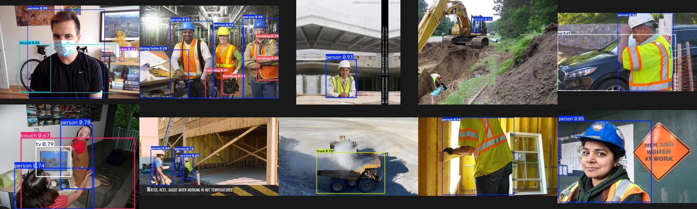

### 3.2. Эксперимент E1: базовое решение (`configs/e1_baseline.yaml`)
- Модель `yolov8n.pt` (`3.01 млн` параметров, `8.2 GFLOPs`) дообучена на 10 классах (`configs/ppe.yaml`) с параметрами из задания: `epochs=50`, `imgsz=640`, `batch=16`, `seed=42`, `deterministic=True`.
- Время обучения на RTX 5070: **559.7 с (9.33 мин)**. Лучшие веса отобраны по проверочной выборке `val` (пик `val mAP@0.5:0.95 = 0.404` на 49-й эпохе) и единожды оценены на замороженном тесте `test`.

### 3.3. Эксперимент E2: одна проверяемая гипотеза (`configs/e2_epochs100.yaml`)
- **Анализ E1 перед постановкой гипотезы:** в журнале обучения E1 (`reports/figures/e1-opora/results.csv`) потери на проверочной выборке (`val/box_loss` и `val/cls_loss`) продолжали снижаться вплоть до 50-й эпохи.
- **Изменяемый фактор (ровно один):** число эпох обучения увеличено с **`50` до `100`**. Все остальные параметры (`yolov8n.pt`, `imgsz=640`, `batch=16`, `seed=42`, `deterministic=True`, разбиение и тест) сохранены строго неизменными.
- **Гипотеза:** увеличение числа эпох позволит модели полнее сойтись и повысит `mAP@0.5`, `mAP@0.5:0.95` и `Recall` без увеличения задержки работы модели.
- Время обучения E2 на RTX 5070: **821.0 с (13.68 мин)**.

---

## 4. Таблицы конфигураций и метрик

### 4.1. Сводное сравнение E0, E1 и E2 (на замороженной тестовой выборке `test`: 110 кадров, 711 объектов)

> **Пояснение основных метрик:**
> - **IoU** (*Intersection over Union*) — отношение площади пересечения предсказанной и эталонной рамок к площади их объединения (`0..1`).
> - **Precision (точность)** — доля верных срабатываний среди всех предсказаний модели (показывает, насколько мало ложных тревог).
> - **Recall (полнота)** — доля реально существующих объектов, которые модель смогла найти (показывает, насколько мало пропусков).
> - **F1** — сбалансированное (гармоническое) среднее между точностью и полнотой.
> - **mAP@0.5** — средняя площадь под кривой «точность–полнота» по всем 10 классам при пороге совпадения рамок `IoU ≥ 0.50`.
> - **mAP@0.5:0.95** — более строгая средняя точность, усреднённая по 10 порогам `IoU` от `0.50` до `0.95` с шагом `0.05` (проверяет ювелирную точность границ рамок).
> - **p50 / p95 задержки** — медиана и 95-й процентиль (время, быстрее которого обрабатываются 50% и 95% кадров соответственно) полной цепочки обработки.

| Эксперимент | Изменения | Время обучения | `Precision` | `Recall` | `F1` | **`mAP@0.5`** | **`mAP@0.5:0.95`** | Задержка полная `p50 / p95` (RTX 5070) |
| :--- | :--- | :---: | :---: | :---: | :---: | :---: | :---: | :---: |
| **E0** *(на 10 кадрах `val`)* | `yolov8n.pt` (COCO) без обучения | 0 с | — | 0% по СИЗ | — | 0.000 (по СИЗ) | 0.000 (по СИЗ) | — |
| **E1 (`e1-opora`)** | База: `epochs=50`, `imgsz=640`, `batch=16` | **559.7 с (9.3 мин)** | 0.7084 | **0.5540** | 0.6217 | **0.5946** | **0.3575** | **14.75 / 23.72 мс** |
| **E2 (`e2-epochs100`)** | Гипотеза: только `epochs=100` | 821.0 с (13.7 мин) | **0.7461** | 0.5391 | **0.6259** | 0.5849 | 0.3477 | 15.26 / 21.67 мс |

**Результат проверки гипотезы E2:** гипотеза о росте `mAP` и `Recall` **не подтвердилась** (`mAP@0.5`: `−0.97 п.п.`, `mAP@0.5:0.95`: `−0.98 п.п.`, `Recall`: `−1.49 п.п.`), хотя `Precision` вырос на `+3.77 п.п.` (`0.708 → 0.746`). По кривой обучения E2 видно, что после ~70-й эпохи на малом датасете (485 кадров) ошибка на обучении продолжала падать (`0.637 → 0.504`), а на проверке `val` вышла на плато и слегка выросла (`0.963 → 0.971`) — началось умеренное **переобучение** (запоминание обучающих примеров в ущерб обобщению). В качестве **лучшей модели** для дальнейшего анализа выбрана **E1 (`e1-opora`)** благодаря более высоким `mAP@0.5`, `mAP@0.5:0.95` и полноте `Recall` (что критично для обнаружения нарушений СИЗ).

### 4.2. Метрики по каждому из 10 классов на тесте (`E1` и `E2`)

| ID | Класс | Объектов в `test` | E1 `P` | E1 `R` | E1 `AP@0.5` | E1 `AP@0.5:0.95` | E2 `AP@0.5` | Δ `AP@0.5` (E2−E1) |
| :-: | :--- | :---: | :---: | :---: | :---: | :---: | :---: | :---: |
| 0 | `Hardhat` | 81 | 0.851 | 0.635 | 0.702 | 0.503 | **0.715** | +0.013 |
| 1 | `Mask` *(мало объектов)* | 24 | 0.957 | 0.833 | 0.875 | 0.558 | **0.888** | +0.013 |
| 2 | `NO-Hardhat` *(критичный)* | 56 | 0.615 | 0.554 | 0.559 | 0.332 | **0.581** | +0.022 |
| 3 | `NO-Mask` | 69 | 0.660 | 0.464 | **0.502** | 0.185 | 0.485 | −0.017 |
| 4 | `NO-Safety Vest` *(критичный)* | 81 | 0.636 | 0.495 | **0.578** | 0.314 | 0.530 | −0.048 |
| 5 | `Person` | 165 | 0.776 | 0.642 | **0.707** | 0.459 | 0.678 | −0.029 |
| 6 | `Safety Cone` | 72 | 0.774 | 0.514 | **0.550** | 0.308 | 0.495 | −0.055 |
| 7 | `Safety Vest` | 55 | 0.788 | 0.582 | 0.636 | 0.341 | **0.640** | +0.004 |
| 8 | `machinery` | 69 | 0.725 | 0.667 | **0.721** | 0.482 | 0.695 | −0.026 |
| 9 | `vehicle` *(всего на 7 кадрах)* | 39 | 0.300 | 0.154 | 0.117 | 0.093 | **0.143** | +0.026 |

> **Замечание об осторожной интерпретации:** у класса `Mask` в тесте всего `24` объекта, а у `vehicle` — `39` объектов, сосредоточенных лишь на `7` изображениях (преимущественно мелкий фон); поэтому различия в 1–3 процентных пункта статистически невысоки и интерпретируются осторожно. Без проседающего класса `vehicle` средний `mAP@0.5` по 9 целевым классам у E1 составляет **`0.648`**.

### 4.3. Графики метрик лучшей модели E1 (матрица ошибок, PR-кривая и зависимость от порога уверенности)

В трактовке `Ultralytics` матрица ошибок (**confusion matrix**) имеет дополнительную строку/столбец `background` (фон): объекты, попавшие в строку `background`, — это ложные срабатывания (FP), а объекты, попавшие в столбец `background`, — пропуски эталонных объектов (FN).

| Нормированная матрица ошибок (E1, `test`) | Кривая точность–полнота `PR` (E1, `test`) |
| :---: | :---: |
| 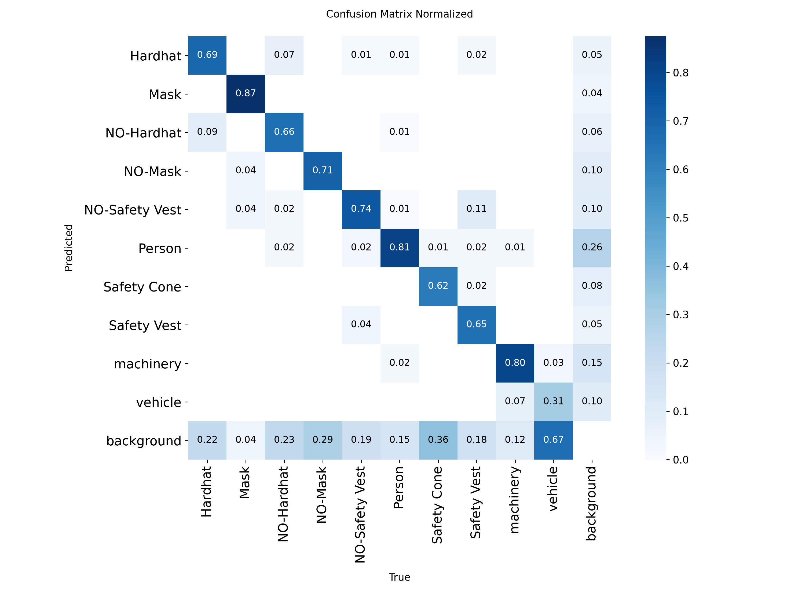 | 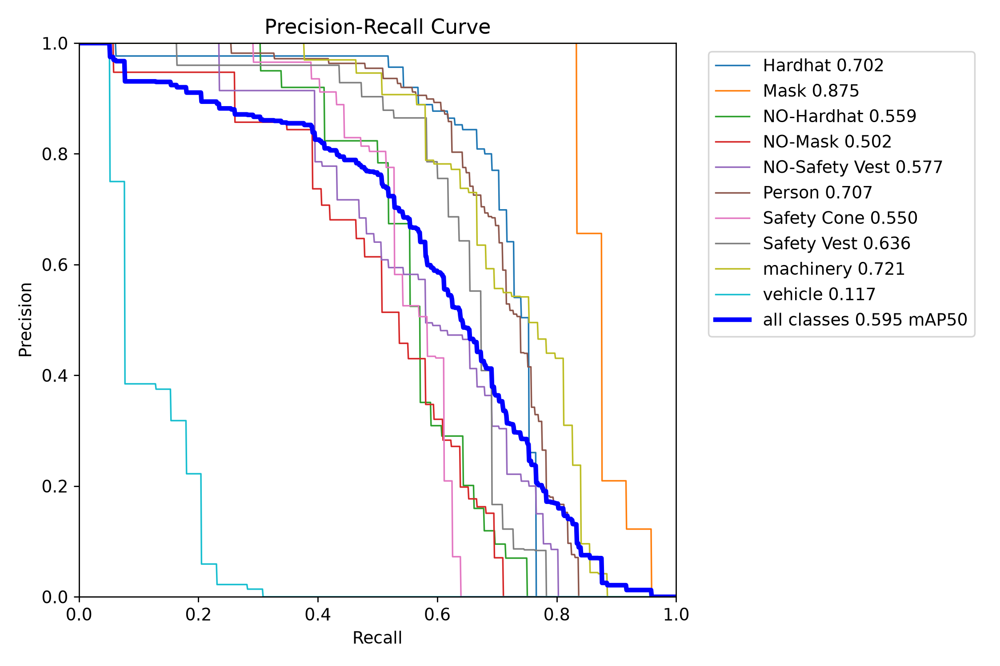 |

| Зависимость `F1` от порога уверенности (E1) | Динамика потерь и метрик при обучении (E1) |
| :---: | :---: |
| 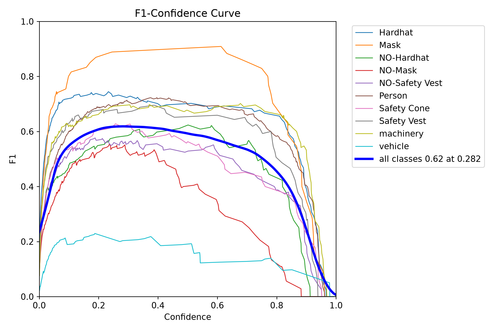 | 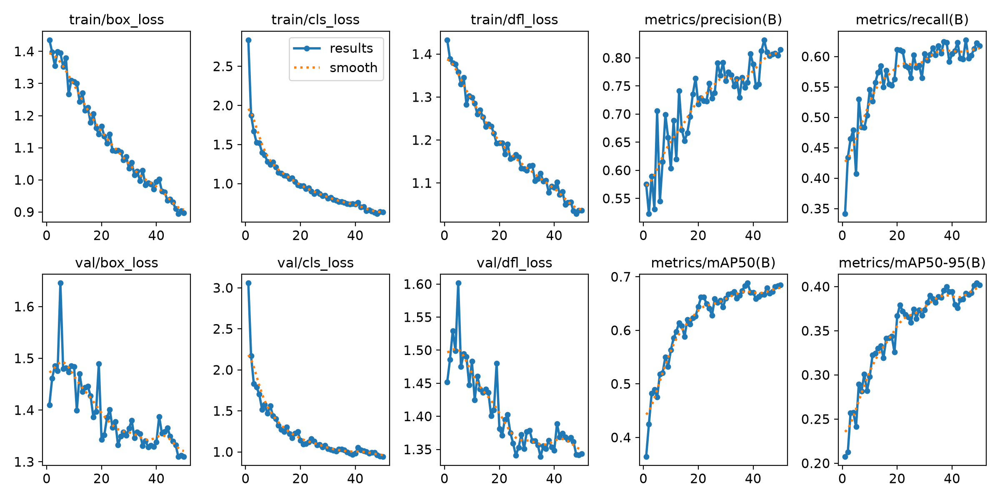 |

*(Дополнительные графики `BoxP_curve.png`, `BoxR_curve.png`, `confusion_matrix.png` для E1 и полный комплект графиков для E2 также сохранены в каталогах `reports/figures/e1-opora/` и `reports/figures/e2-epochs100/`.)*

---

## 5. Визуализация и разбор ошибок (6 галерей, 12 примеров)

Повторно используемый скрипт `src/error_analysis.py` прогнал модель **E1** на всех 110 тестовых изображениях (`conf=0.25`, `iou_nms=0.45`) и сформировал **6 отдельных галерей ошибок** (зелёным обозначена эталонная разметка `GT`, синим — предсказания модели `P`, ярким жёлтым/красным — выделенная ошибка; полный каталог: `reports/error_galleries/error_catalog.json`):

1. **Ложноположительные срабатывания с высокой уверенностью** (14 случаев на 10 кадрах): [01_high_conf_fp_gallery.jpg](error_galleries/01_high_conf_fp_gallery.jpg)
2. **Пропуски критичного класса (`NO-Hardhat`, `NO-Safety Vest`)** (66 случаев на 33 кадрах): [02_missed_critical_gallery.jpg](error_galleries/02_missed_critical_gallery.jpg)
3. **Сопоставленные рамки с низким IoU (`0.15 ≤ IoU < 0.50`)** (48 случаев на 31 кадре): [03_low_iou_matches_gallery.jpg](error_galleries/03_low_iou_matches_gallery.jpg)
4. **Путаница между похожими классами** (36 случаев на 25 кадрах): [04_class_confusion_gallery.jpg](error_galleries/04_class_confusion_gallery.jpg)
5. **Малые и перекрытые объекты** (267 пропусков на 65 кадрах): [05_small_and_occluded_gallery.jpg](error_galleries/05_small_and_occluded_gallery.jpg)
6. **Предположительные ошибки эталонной разметки** (3 автоматических кандидата + подтверждённые глазами): [06_suspected_gt_errors_gallery.jpg](error_galleries/06_suspected_gt_errors_gallery.jpg)

| Галерея 1: Высокоуверенные FP | Галерея 4: Путаница похожих классов |
| :---: | :---: |
| 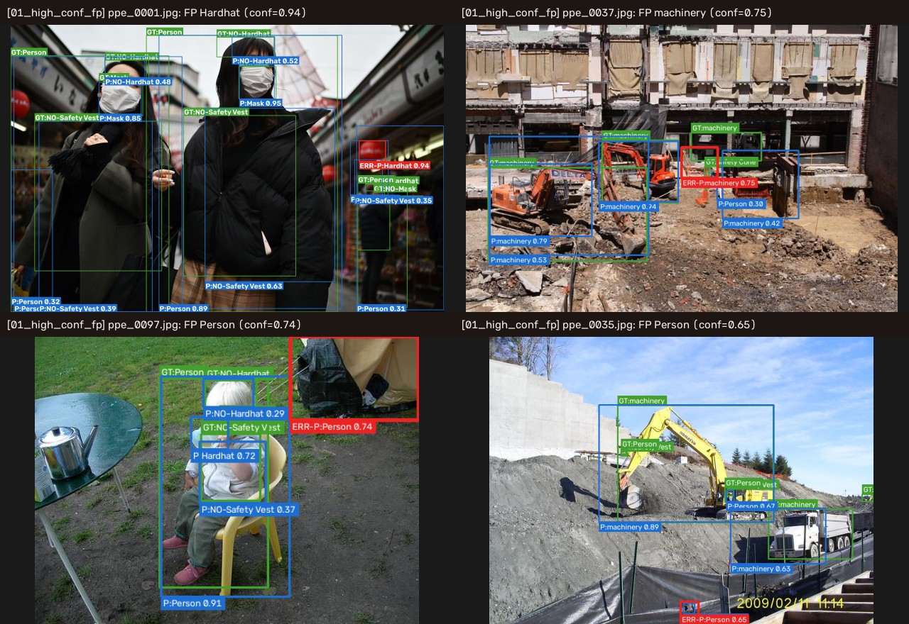 | 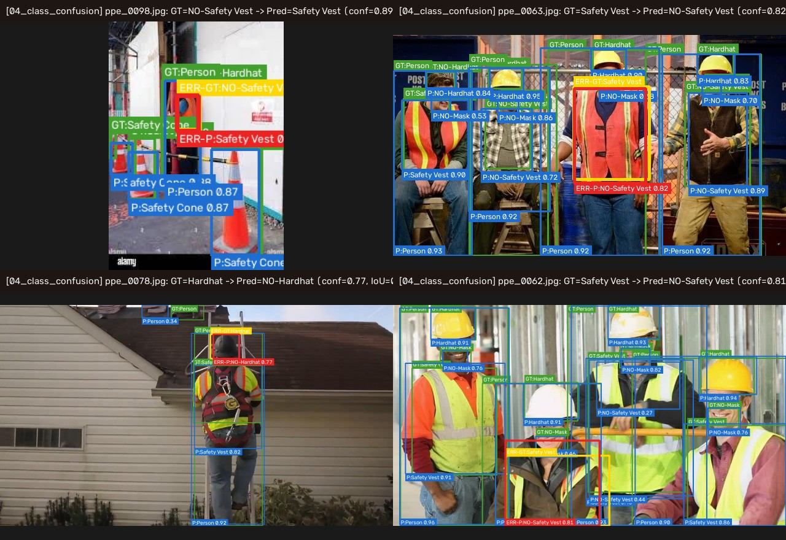 |

| Галерея 2: Пропуски критичных СИЗ | Галерея 5: Малые и перекрытые объекты |
| :---: | :---: |
| 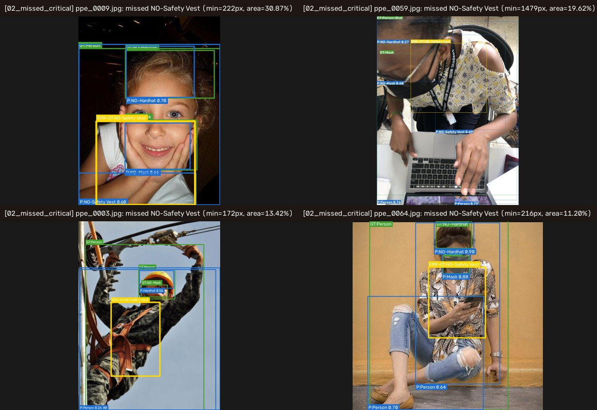 | 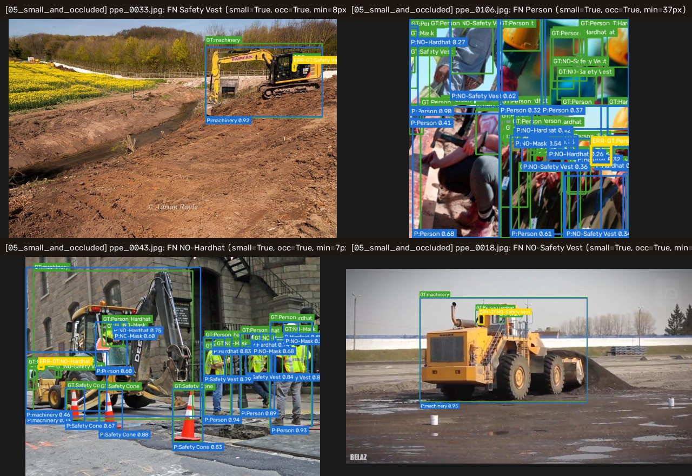 |

### Таблица разбора 12 конкретных примеров ошибок с распределением причин

| № | Кадр (галерея) | Фактическое поведение модели на изображении | Распределение причины |
| :-: | :--- | :--- | :--- |
| 1 | `ppe_0001.jpg` *(гал. 1 / 6)* | На городской улице (Япония, не стройка) круглый красный фонарик над прохожим принят за `Hardhat` с уверенностью `0.94`. | **Сдвиг условий съёмки (домен) + модель** |
| 2 | `ppe_0037.jpg` *(гал. 1)* | Оранжевый фрагмент фона позади экскаватора распознан как `machinery (0.75)`, а на самом экскаваторе остались две смещённые рамки `machinery (0.79 и 0.53)`. | **Модель + порог / NMS** *(подавление немаксимумов не удалило вторую рамку из-за IoU < 0.45)* |
| 3 | `ppe_0097.jpg` *(гал. 1 / 6)* | Бытовое фото ребёнка в парке: сложенная палатка распознана как `Person (0.74)`, светлая кофта — как `Hardhat (0.72)`. | **Данные (чужеродные фото) + модель** |
| 4 | `ppe_0035.jpg` *(гал. 1 → 6)* | У нижнего края кадра виден реальный человек, обрезанный рамкой; модель верно нашла `Person (0.65)`, но разметчик пропустил его в эталоне. | **Разметка (пропуск объекта в GT)** |
| 5 | `ppe_0009.jpg` *(гал. 2)* | Портрет ребёнка: модель нашла `NO-Safety Vest (0.60)` в области плеч, но в эталоне рамка ошибочно натянута на лицо и руки → `IoU < 0.50`, засчитан пропуск. | **Разметка + данные (нецелевой домен)** |
| 6 | `ppe_0003.jpg` *(гал. 2)* | Человек в камуфляже и страховочной обвязке на канате: каска найдена (`0.56`), но `NO-Safety Vest` пропущен из-за ремней обвязки и непривычного ракурса. | **Сдвиг условий съёмки (ракурс/одежда) + модель** |
| 7 | `ppe_0059.jpg` *(гал. 3)* | Вид сверху на человека за ноутбуком (`2160×3840`): выданы две конкурирующие рамки `Person` (`0.76` на тело и `0.79` на руку, `IoU=0.23`), которые не склеил NMS. | **NMS + сдвиг ракурса** |
| 8 | `ppe_0042.jpg` *(гал. 3)* | В кадр попал только ковш экскаватора у правого края: `machinery (0.94)` получил `IoU = 0.48`, не дотянув всего `0.02` до порога совпадения `0.50`. | **Порог (`IoU=0.50`) + обрезанный объект** |
| 9 | `ppe_0098.jpg` *(гал. 4 → 6)* | На рабочем за конусами реально надет оранжевый жилет: модель верно предсказала `Safety Vest (0.89, IoU=0.95)`, а в эталонной разметке ошибочно стоял `NO-Safety Vest`. | **Разметка (ошибочный класс в GT)** |
| 10 | `ppe_0078.jpg` *(гал. 4)* | Рабочий на лестнице спиной к камере в **чёрной каске**: модель перепутала чёрную каску с тёмными волосами и выдала `NO-Hardhat (0.77, IoU=0.90)`. | **Данные (мало чёрных касок в обучении) + модель** |
| 11 | `ppe_0062.jpg` *(гал. 4)* | Поверх жёлтого жилета надета расстёгнутая тёмная куртка, скрывающая большую часть жилета → модель классифицировала область как `NO-Safety Vest (0.81)`. | **Частичное перекрытие + модель** |
| 12 | `ppe_0033.jpg` и `ppe_0043.jpg` *(гал. 5)* | Жилет водителя за стеклом кабины (`8 px`) и дальняя голова без каски (`7 px`) при сжатии кадра к `640×640` становятся размером 3–4 пикселя и полностью теряются. | **Модель / низкое входное разрешение (`imgsz=640`) + перекрытие** |

**Суммарный вывод анализа ошибок:** примерно треть «формальных» ошибок связана с **качеством самих исходных данных и разметки** (посторонние нестроительные фото, забытые или неверные метки), а среди истинных ошибок модели доминируют **мелкие и перекрытые объекты** (267 пропусков) и **редкие визуальные вариации СИЗ** (чёрная каска, жилет под курткой).

---

## 6. Системная оценка (задержка, память, ложные тревоги, устойчивость и регламент эксплуатации)

### 6.1. Задержка по этапам, пропускная способность и память (`src/benchmark_latency.py`)
Замеры выполнены на всех 110 тестовых кадрах на **NVIDIA GeForce RTX 5070** после 15 прогревочных запусков нейросети и CUDA-ядра NMS с явной синхронизацией GPU (`reports/metrics/latency_benchmark.json`):

| Этап полной цепочки обработки (E1, `imgsz=640`) | Среднее (`mean`) | Медиана (`p50`) | 95-й процентиль (`p95`) |
| :--- | :---: | :---: | :---: |
| 1. Чтение и декодирование JPEG с диска | 3.82 мс | 2.57 мс | 9.53 мс |
| 2. Изменение размера (`letterbox 640`) + перенос на GPU | 2.44 мс | 2.20 мс | 3.24 мс |
| 3. Инференс ядра модели `YOLOv8n` (GPU) | 7.25 мс | 7.58 мс | 9.51 мс |
| 4. Постобработка (`NMS` + масштабирование рамок) | 2.46 мс | 1.95 мс | 3.76 мс |
| **Итого: полная цепочка (`End-to-End`)** | **15.96 мс** | **14.75 мс** | **23.72 мс** |

- **Пропускная способность (FPS — кадров в секунду):** только ядро нейросети — **`138.0 FPS`**, вся цепочка целиком — **`62.6 FPS`**, гарантированная скорость по `p95` — **`42.2 FPS`**. Более половины времени (~55%) занимает не сама нейросеть, а декодирование крупных фото, ресайз и NMS.
- **Память:** RAM процесса — `1558.8 МБ`, пиковая видеопамять GPU (VRAM) — всего **`73.8 МБ`** (выделено) / `116.0 МБ` (зарезервировано).
- **Число ложных тревог (FP) на 100 кадров** для E1:
  - при пороге `conf = 0.25`: `117.3` по всем классам и **`28.2`** по критичным нарушениям (`NO-Hardhat` + `NO-Safety Vest`), что при анализе видео со скоростью 5 кадров/с эквивалентно ~84.5 ложным тревогам в минуту (неприемлемо без фильтрации);
  - при пороге `conf = 0.50`: `44.6` по всем классам и **`10.9`** по критичным нарушениям (снижение ложных тревог в **2.6 раза**).

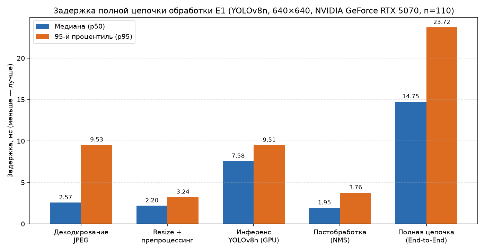

### 6.2. Стресс-тест устойчивости к освещению, ракурсу и перекрытию (`src/stress_test_robustness.py`)

| Сценарий (110 кадров `test`, E1) | `mAP@0.5` | Δ `mAP@0.5` | `Precision` *(conf=0.25)* | `Recall` *(conf=0.25)* | `Recall` крит. СИЗ |
| :--- | :---: | :---: | :---: | :---: | :---: |
| Исходные кадры (`baseline`) | **0.6165** | — | 0.750 | 0.563 | 0.518 |
| Сумерки (`brightness ×0.45`) | 0.6143 | −0.0022 | 0.759 | 0.546 | 0.547 |
| Наклон камеры (`±10°`) | 0.6041 | −0.0124 | 0.783 | 0.539 | 0.504 |
| Сильная засветка (`×1.55 + 25`) | 0.5789 | **−0.0376** | 0.737 | 0.529 | 0.489 |
| Частичное перекрытие (~12% кадра) | **0.4533** | **−0.1632** | **0.619** | **0.439** | **0.394** |

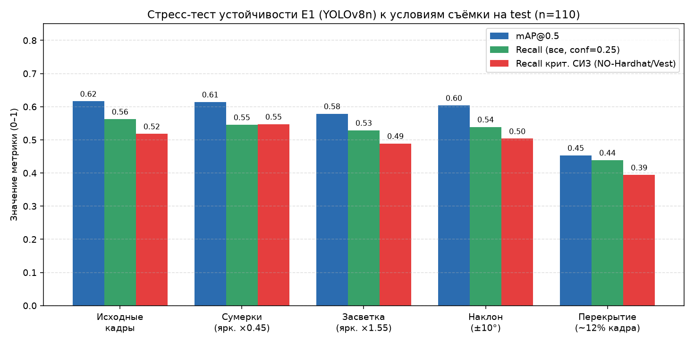

Модель устойчива к умеренным сумеркам и наклону камеры ±10°, умеренно теряет качество при засветке (`−3.8 п.п.`), но **резко деградирует при частичном перекрытии (`−16.3 п.п.`, пропуск более 60% критичных нарушений)**.

### 6.3. Правило отказа от автоматического решения, контроль сдвига и схема отката
1. **Правило отказа и передачи случая оператору (human-in-the-loop):**
   - Автоматические санкции и блокировка доступа без участия человека запрещены.
   - При попадании уверенности в «серую зону» **`0.25 ≤ conf < 0.55`** (реализовано в `src/predict.py` флагом `needs_operator_review`) или при одновременном обнаружении противоречивых классов в одной зоне (`Hardhat` и `NO-Hardhat` с `IoU ≥ 0.40`) автоматическое решение отменяется, а кадр отправляется оператору.
   - Для снижения ложных тревог на видеопотоке применяется **временное сглаживание**: оповещение оператору формируется только при подтверждении нарушения минимум на **3 из 5 подряд идущих кадров**.
2. **Контроль сдвига распределения (Data Drift Monitoring):**
   - По каждой камере непрерывно отслеживаются средняя яркость/резкость кадра, средняя уверенность предсказаний (`mean conf`), доля кадров в зоне неуверенности и число тревог на 100 кадров.
   - Проводится регулярный выборочный ручной аудит (50 случайных кадров в неделю), особенно при смене сезона (зимняя спецодежда, снег, дождь).
3. **Схема отката версии (Rollback):**
   - Каждая модель версионируется неизменяемым пакетом (`best.pt` + YAML-конфиг + `SHA-256` + протокол метрик на замороженном тесте).
   - Обновление выкатывается поэтапно: сначала в **теневом режиме** (*shadow mode* — модель работает параллельно со старой без показа тревог операторам), затем канареечно на 10% камер.
   - При росте ложных тревог более чем на `+30%`, росте задержки `p95 > 40 мс` или скачке доли отказов выполняется мгновенный откат на предыдущую проверенную версию через переключение симлинка/переменной конфигурации.

---

## 7. Выводы, ограничения и следующий эксперимент

### Выводы
1. Создан полностью воспроизводимый конвейер детекции СИЗ на базе **YOLOv8n** с 10 классами, нулевой утечкой между выборками (444 независимые группы) и автоматическими проверками (`pytest`: 6/6 пройдены за 5.72 с).
2. Перенос обучения с предобученной модели `yolov8n.pt` (E0: `0%` по СИЗ) позволил в базовом эксперименте **E1** достичь **`mAP@0.5 = 0.595`**, **`mAP@0.5:0.95 = 0.358`** и **`Recall = 0.554`** при скорости полной цепочки **`62.6 FPS`** (`p95 = 23.72 мс`) на RTX 5070.
3. Проверка гипотезы **E2** (`epochs: 50 → 100`) показала, что простое удлинение обучения на малом датасете (485 кадров) повышает `Precision` (+3.8 п.п.), но вызывает умеренное переобучение после 70-й эпохи и слегка снижает `mAP@0.5` (`−1.0 п.п.`) и `Recall` (`−1.5 п.п.`).

### Ограничения
- Небольшой объём обучающей выборки (485 кадров) и присутствие посторонних нестроительных фото в исходном наборе Roboflow (бытовые видео, COVID-маски, парки).
- Низкая полнота на мелких и перекрытых объектах (`Recall = 0.554`, при перекрытии падает до `0.439`) и провал по разнородному классу `vehicle` (`AP@0.5 = 0.117`).
- Малая представленность реальных верхних CCTV-ракурсов, зимней одежды и тёмных касок.

### Следующий эксперимент (рекомендация)
Поскольку E2 доказал, что проблема не в нехватке эпох, логичным следующим шагом является **E3: увеличение входного разрешения `imgsz: 640 → 960`** (при тех же `epochs=50` и `yolov8n.pt`) для повышения полноты на мелких головах/касках/конусах, а затем — **очистка датасета от посторонних бытовых кадров и добор 300–500 кадров с реальных обзорных CCTV-камер строек** (включая тёмные каски и зимнюю одежду).

---

## 8. Инструкции воспроизведения и раздел «Использование ИИ»

### 8.1. Воспроизведение с нуля
Подробные команды приведены в корневом [README.md](../README.md). Краткая последовательность:
```powershell
# 1. Создание окружения и установка зафиксированных зависимостей (CUDA 12.8 для RTX 5070)
python -m venv .venv
.\.venv\Scripts\python.exe -m pip install -r requirements.txt

# 2. Поместить архив Roboflow v30 (SHA-256 в data/README.md) в data/raw/ и подготовить данные
.\.venv\Scripts\python.exe src\unpack_and_inspect.py
.\.venv\Scripts\python.exe src\prepare_dataset.py

# 3. Запустить автотесты (6 быстрых проверок)
.\.venv\Scripts\python.exe -m pytest -v

# 4. Запустить эксперименты E0, E1, E2, бенчмарк, галереи ошибок и стресс-тест
.\.venv\Scripts\python.exe src\run_e0_pretrained.py
.\.venv\Scripts\python.exe src\train_and_eval.py --config configs/e1_baseline.yaml
.\.venv\Scripts\python.exe src\train_and_eval.py --config configs/e2_epochs100.yaml
.\.venv\Scripts\python.exe src\benchmark_latency.py
.\.venv\Scripts\python.exe src\error_analysis.py
.\.venv\Scripts\python.exe src\stress_test_robustness.py

# 5. Быстрый сценарий демонстрации на одном изображении (для защиты)
.\.venv\Scripts\python.exe src\predict.py --image data/processed/test/images/ppe_0063.jpg --save reports/figures/demo_pred_ppe_0063.jpg
```

### 8.2. Использование ИИ-инструментов (по разделу 6 Общих требований)
1. **Инструмент и задача:** ИИ-ассистент *Antigravity* (среда разработки с терминалом) применялся пошагово для генерации и отладки скриптов подготовки данных, обучения/оценки YOLOv8, построения галерей ошибок, бенчмарка задержки, автотестов `pytest` и структурирования документации.
2. **Существенная часть запросов (без секретов и персональных данных):** поэтапная разработка воспроизводимого пайплайна для Лабораторной работы №3 (распаковка с обходом ограничения `MAX_PATH` на Windows, групповое разбиение 70/15/15 без утечек, конфиги E1/E2, визуализация 6 галерей ошибок, замер `p50`/`p95` по этапам, автотесты); уточняющие вопросы по смыслу метрик и выбору гипотезы E2 (`epochs: 50 → 100`).
3. **Какие предложения приняты, изменены или отклонены:**
   - *Принято:* выбор сырой версии `v30` без «запечённых» аугментаций, сведение 25 классов к 10 каноническим, группировка по видео + `pHash`, архитектура модулей `src/` и 6 автотестов.
   - *Изменено автором работы:* вместо предложенной ИИ гипотезы `imgsz: 640 → 960` выбрана гипотеза увеличения числа эпох `50 → 100` (подтверждена анализом кривой потерь E1); по результатам **личного ручного осмотра 40 изображений** выявлена ошибка класса на кадре `random_30/01` (`Hardhat` на наушниках), после чего в код внесено адресное исправление; изменены правила жадного распределения в `prepare_dataset.py` (первый вариант дал перекос `59/18/23`, исправлен до `68.6/15.8/15.6`).
   - *Отклонено:* автоматическое скачивание датасета с Kaggle (архив скачан вручную с Roboflow Universe).
4. **Проверка результата тестом, документацией и экспериментом:**
   - каждый сгенерированный скрипт запускался локально на реальных данных и GPU RTX 5070;
   - выявленные при запуске ошибки API (отсутствие `ops.non_max_suppression` в Ultralytics 8.4 → исправлено на `nms.non_max_suppression`; вызов `torch.cuda.reset_peak_memory_stats` до инициализации CUDA; холодный старт CUDA-ядра NMS без прогрева) обнаружены и исправлены;
   - пройдены все 6 автоматических тестов `pytest` (`6 passed in 5.72s`) и визуально проверены все 6 сгенерированных галерей ошибок.
5. **Известные риски:**
   - лицензия: использован только открытый датасет `CC BY 4.0` и открытые веса `yolov8n.pt`;
   - риск выдуманного программного интерфейса (проявился на `ultralytics.utils.ops.non_max_suppression` и был пойман при запуске);
   - утечка данных: закрытые и персональные данные не передавались и не использовались;
   - ответственность за весь принятый код, эксперименты и выводы полностью сохраняется за автором работы.

---

## 9. Краткие ответы на контрольные вопросы (для устной защиты)

1. **Как сопоставление превращает множество рамок в TP, FP и FN?**  
   Предсказания сортируются по убыванию уверенности (`confidence`). Для каждой предсказанной рамки ищется ещё не занятая эталонная рамка **того же класса** с наибольшим `IoU`. Если `IoU ≥ 0.50`, пара засчитывается как **TP** (истинно положительная), и эталон помечается занятым. Предсказания без пары (промах, неверный класс, `IoU < 0.50` или дубликат) становятся **FP** (ложными срабатываниями). Оставшиеся непокрытыми эталонные рамки — это **FN** (пропуски).
2. **Почему повторное обнаружение одного объекта считается ложноположительным (FP)?**  
   Потому что реальному физическому объекту соответствует только одна эталонная рамка. После того как лучшая предсказанная рамка «забрала» этот эталон в TP, вторая рамка поверх того же объекта уже не может сопоставиться с новым объектом и считается лишней (дубликатом — FP). Именно для борьбы с дубликатами применяется **NMS** (подавление немаксимумов).
3. **Чем `mAP@0.5` отличается от `mAP@0.5:0.95`?**  
   `mAP@0.5` считает среднюю площадь под PR-кривой по всем классам при одном мягком пороге совпадения рамок `IoU = 0.50`. `mAP@0.5:0.95` вычисляет это значение для **10 порогов** (`0.50, 0.55, ..., 0.95`) и берёт среднее — поэтому она намного строже штрафует неточную локализацию границ рамки (в нашей E1: `0.595` против `0.358`).
4. **Почему соседние кадры в обучающей и тестовой выборках создают утечку?**  
   Соседние кадры одного видео отличаются на несколько пикселей (тот же человек, фон, освещение и одежда). Если один кадр попал в `train`, а соседний — в `test`, модель просто «узнаёт» запомненную сцену, завышая тестовый `mAP`, но на реальной новой камере её качество резко падает.
5. **Как порог уверенности меняет точность и полноту?**  
   Повышение порога (`conf: 0.25 → 0.50`) отсекает сомнительные рамки: число ложных тревог (FP) падает и **Precision растёт**, но часть реальных объектов отбрасывается и **Recall падает** (в нашем замере критичные FP упали с `28.2` до `10.9` на 100 кадров). Снижение порога даёт обратный эффект.
6. **Почему число кадров в секунду (FPS) для самой модели не равно пропускной способности всей службы?**  
   Помимо прогона нейросети на GPU (`7.25 мс` → `138 FPS`), реальная служба тратит время на чтение/декодирование видео или JPEG (`3.82 мс`), изменение размера и перенос тензора (`2.44 мс`), постобработку NMS (`2.46 мс`), а в продакшене ещё и на сетевую передачу, логику тревог и запись в БД. В нашем замере полная цепочка дала `62.6 FPS` (`p95: 42.2 FPS`) — более чем вдвое медленнее «чистого ядра».
